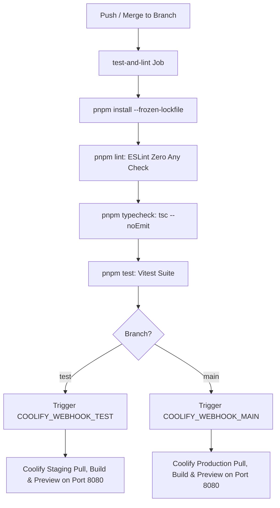

# ISP Omnichannel Operator Platform — Frontend

Modern, high-performance web console for customer support agents, technical staff, and administrators of an Internet Service Provider (ISP). Built with **React 19**, **Vite**, **TanStack Router**, **TanStack Query**, **TailwindCSS**, and **Radix UI**.

---

## 1. Architectural Overview & Tech Stack

- **Framework & Runtime**: React 19 + Vite + TypeScript (Strict Mode).
- **Routing & State**: TanStack Router with type-safe route trees and TanStack Query (React Query) for server-state synchronization.
- **Styling & UI**: TailwindCSS, Radix UI accessible primitives, and Lucide Icons.
- **Real-Time Communication**: WebSocket client connecting to the backend gateway for live case events, messages, and availability updates.
- **Code Quality**: ESLint flat config with strict rules, zero-tolerance policy on `any` types, and Vitest suite covering components and hooks.

---

## 2. CI/CD & Deployment Guide (Test & Production)

Frontend deployments are automated via **GitHub Actions** and **Coolify**.

### Pipeline Workflow (`.github/workflows/deploy.yml`)



### Steps to Deploy

#### Deploying to Test (Staging)
1. Merge feature branch into `develop` or submit a Pull Request to `test`.
2. Push or merge changes to `test`:
   ```bash
   git checkout test
   git pull origin test
   git merge feature/your-feature-branch
   git push origin test
   ```
3. The GitHub Actions runner executes `pnpm lint`, `pnpm typecheck`, and `pnpm test`.
4. If green, the action sends an authenticated `GET` request with `Authorization: Bearer $COOLIFY_API_TOKEN` to the staging webhook.
5. Coolify rebuilds the Docker container and runs `pnpm preview --port 8080 --host 0.0.0.0`.

#### Deploying to Production (Prod)
1. After staging QA verification, create a Pull Request from `test` into `main`.
2. Merge and push to `main`:
   ```bash
   git checkout main
   git pull origin main
   git merge test
   git push origin main
   ```
3. GitHub Actions performs full validation and triggers `COOLIFY_WEBHOOK_MAIN`.

---

## 3. Environment Variables

Create a `.env` file in the root directory (or configure via Coolify environment settings):

```env
# URL of the backend REST and WebSocket API
VITE_API_URL=http://localhost:3000

# Optional Sentry / Telemetry DSN
VITE_SENTRY_DSN=
```

---

## 4. Production Operations & Features Log (2026-10-28)

### 1. Multi-Queue Availability Popover for Substitute Agents (`AppShell.tsx`)
- **El Daño (Damage)**: Agents assigned to multiple departments (e.g. Sales as primary, Technical Support as substitute) were unable to selectively activate or pause their availability per queue. If they toggled available, they were inundated with cases from all departments. Furthermore, administrators with `primary_department_id: null` suffered a fatal UI crash (`TypeError: Cannot read properties of null`) upon opening the status menu.
- **El Porqué (Root Cause)**: The previous interface was a simple binary toggle bound to `auto_assign_enabled`. The availability normalization logic did not handle nullable primary department IDs or independent departmental queue IDs (`activeDepartmentIds`).
- **La Solución (Fix)**:
  - Redesigned the status menu in `AppShell.tsx` into an interactive Popover with a master auto-assign switch and individual departmental toggles with visual badges (`[Principal]` vs `[Suplente]`).
  - Added robust null-safety guards in `useAvailability` and `AppShell` for global administrator profiles.

### 2. Contract Selector & Geographic Enrichment (`CasePanel.tsx`)
- **El Daño (Damage)**: When an ISP customer has multiple active subscriptions (e.g. residential and business contracts), agents had no way to inspect or switch contracts within the case panel. Diagnostic actions ran on an arbitrary contract, and sector/neighborhood names were absent.
- **El Porqué (Root Cause)**: The panel only displayed a single static contract object and lacked multi-contract awareness.
- **La Solución (Fix)**:
  - Built an interactive contract dropdown (`#5279 (Sector)`) in `CasePanel.tsx` that displays all subscriber contracts and allows immediate switching.
  - Linked selected contract metadata directly to OLT/MikroTik diagnostic triggers.

### 3. On-Demand Case Balance Resynchronization (`CasePanel.tsx`)
- **El Daño (Damage)**: Balance values were frozen at case creation. If the subscriber paid via bank transfer or accounting updated their ledger in Excel/ERP, the agent could not refresh the balance without closing or recreating the case.
- **El Porqué (Root Cause)**: The frontend lacked an action button and API trigger for live balance synchronization.
- **La Solución (Fix)**:
  - Implemented an 'Actualizar saldo' button with an animated loading spinner in `CasePanel.tsx` calling `POST /api/cases/:id/sync-balance`.
  - Subscribed to `case:updated` WebSocket notifications to dynamically re-render the billing card.

### 4. Expandable OLT Diagnostic History & CLI Inspector (`CaseSummaryDialog.tsx`, `OperationalInboxView.tsx`)
- **El Daño (Damage)**: Network diagnostic failures presented only a generic red alert. Agents could not discern if the failure was caused by optical signal loss, an unreachable router, or an offline ONT.
- **El Porqué (Root Cause)**: Dialog timeline rendered entries as flat plain text, ignoring structured execution outputs.
- **La Solución (Fix)**:
  - Built expandable timeline milestone cards in `CaseSummaryDialog.tsx` and `OperationalInboxView.tsx`.
  - Displays optical power levels in dBm (Rx/Tx) with color-coded signal quality indicators, failed step highlights, and dark-themed code blocks displaying raw OLT CLI output with one-click clipboard copy.

### 5. Network Topology Management Vault (`NetworkSettingsCard.tsx`)
- **El Daño (Damage)**: Network router and OLT credentials were hardcoded in backend configuration files, preventing operators from adding or modifying network nodes without code deploys.
- **El Porqué (Root Cause)**: Lack of dedicated administrative UI for infrastructure management.
- **La Solución (Fix)**:
  - Built `NetworkSettingsCard.tsx` under `/configuracion` for CRUD operations on MikroTik routers and OLTs.

### 6. Strict TypeScript Typing & Zero Any Policy
- **El Daño (Damage)**: 11 ESLint errors for explicit `any` types in diagnostic dialogs and case panels blocked CI/CD pipelines.
- **El Porqué (Root Cause)**: Untyped payload projections and unsafe type assertions (`as any`).
- **La Solución (Fix)**:
  - Declared strict typed models (`ContractDto`, `ExtendedContractCardItem`, `DiagnosticHistoryEntry`).
  - Achieved 100% clean check: 0 ESLint warnings/errors, 0 TypeScript compilation errors, and 355/355 Vitest tests passing.

---

## 5. Development & Testing Commands

```bash
# Install dependencies
pnpm install

# Start Vite development server (port 5173 by default)
pnpm run dev

# Run ESLint validation
pnpm run lint

# Run TypeScript typecheck
pnpm run typecheck

# Run Vitest test suite
pnpm run test

# Build production bundle
pnpm run build
```
